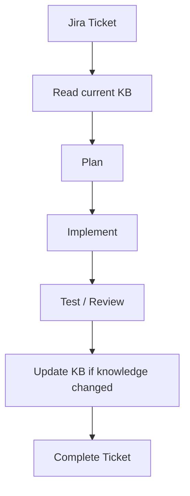

# Tutor Marketplace Knowledge Base

`tutor-kb` is the documentation source of truth for the Tutor Marketplace project. It records confirmed architecture, shared domain language, project conventions, and accepted technical decisions for both developers and AI agents.

This repository contains documentation only. Application code belongs in the frontend or backend repositories.

## Repository ecosystem

| Repository / system | Responsibility | Current state |
| --- | --- | --- |
| `tutor-frontend` | Angular 22.2.2 client using TypeScript 6.0.3, SCSS, hydration, and prerendering | Baseline shell, health check, and auth infrastructure scaffold implemented |
| `tutor-backend` | Spring Boot 4.1.1 service using Java 21 and Maven | Repository initialized; baseline health and security configuration implemented |
| `tutor-kb` | Architecture, domain knowledge, and project rules | Active; this repository |
| Database | Supabase PostgreSQL | Connected; official MVP schema not yet defined |
| Jira | Future ticket and workflow system | Planned to be configured next |
| MCP integrations | Future agent integrations | Not configured |
| `tutor-agent` | Future Planner, Developer, and Reviewer agents | Not configured |

The local frontend and backend are confirmed to communicate successfully over REST/HTTP. The backend is also connected to Supabase PostgreSQL. The official application schema required for the MVP has not yet been designed or created.

## How context is divided

The target context model, after Jira and agent integrations are configured, is:

```text
Jira       -> What needs to be done
tutor-kb   -> Architecture, domain knowledge, and project rules
Source     -> Current implementation
```

- Once Jira is configured, use it for ticket scope and acceptance criteria.
- Use this KB for agreed project context and constraints.
- Inspect source repositories for the current implementation.
- If these sources conflict, do not guess. Record the discrepancy, resolve it with the project team, and update the affected sources.

## Documentation status vocabulary

| Label | Meaning |
| --- | --- |
| **Confirmed** | Provided project fact or accepted decision |
| **Planned** | Intended future work, not current behavior |
| **TBD** / **To be defined** | No decision is recorded yet |

Unmarked detail must not be treated as an approved requirement.

## Knowledge base map

| Area | Contents |
| --- | --- |
| [`product/`](product/scope.md) | Confirmed market, customers, learning modes, MVP scope, and monetization |
| [`architecture/`](architecture/system-overview.md) | System boundaries and frontend/backend structure |
| [`domain/`](domain/user.md) | Domain vocabulary and known boundaries |
| [`api/`](api/conventions.md) | API and error-contract conventions |
| [`database/`](database/schema.md) | Current database connection status; schema source of truth after the planned MVP schema ticket |
| [`standards/`](standards/backend-conventions.md) | Engineering and collaboration conventions |
| [`decisions/`](decisions/README.md) | Architecture Decision Records (ADRs) |

## Product scope

**Confirmed:** Tutor Marketplace serves the Vietnamese market only and supports both online and in-person tutoring.

The product has two separate, mutually exclusive customer account types: Tutor and Tutor Seeker. There is no separate Parent role; students may register directly as Tutor Seekers. The confirmed MVP includes authentication, approved Tutor profiles, tutor discovery, AI recommendations, free connection requests, contact unlock after acceptance, connection history, and reviews from connected Tutor Seekers. These are product requirements, not claims of current implementation.

See [Product Scope](product/scope.md) for the confirmed scope and unresolved details.

Registration and connections are free in the MVP. Connection credits are planned for a later release and have no confirmed price. See [Monetization](product/monetization.md).

Job postings, lesson booking/session management, tutoring-fee payments, and paid connection credits are explicitly post-MVP. Detailed behavior and implementation status remain `TBD` unless a domain document says otherwise.

## Current architecture

```text
Angular Frontend
       |
       | REST/HTTP
       v
Spring Boot Backend
       |
       | JDBC
       v
Supabase PostgreSQL

Official MVP schema: Not yet defined
```

See [System Overview](architecture/system-overview.md) for current and planned architecture boundaries.

The confirmed CV-publication workflow uses AI for pre-validation and an administrator for final approval. See [AI-Assisted CV Review](architecture/ai-cv-review.md).

## Next planned development ticket

After the current KB grooming is completed, the next planned development ticket is **MVP Database Schema Design & Creation**.

- This is roadmap information only.
- Supabase PostgreSQL is already selected, configured, and connected to the backend.
- The ticket will define and create the official database schema required to build the MVP.
- The ticket will define its detailed requirements and acceptance criteria before implementation begins.
- After the ticket is completed and verified, update this KB with the accepted and implemented schema.

## How to use this KB

Before planning or implementation:

1. Read [`architecture/system-overview.md`](architecture/system-overview.md).
2. Read the relevant architecture, domain, API, database, and standards pages.
3. Confirm implementation details in `tutor-frontend` or `tutor-backend`.
4. Treat every `TBD` as an unresolved question, not permission to invent a rule.
5. Once Jira is configured, consult the relevant ticket for task-specific requirements.

The following agent responsibilities are planned. No agent or MCP integration is currently configured.

| Agent | Primary KB usage |
| --- | --- |
| Planner Agent | Identify constraints, dependencies, and unresolved decisions |
| Developer Agent | Implement against documented architecture and conventions |
| Reviewer Agent | Check changes against confirmed rules and decisions |

## Source-of-truth policy

> The Knowledge Base must reflect the actual confirmed state of the project. Planned features, architecture, infrastructure, or business rules must not be documented as implemented.

- Record only verified facts and accepted decisions as confirmed.
- Keep current architecture separate from planned architecture.
- Do not document proposed endpoints, tables, authorization behavior, payment rules, or matching logic as if they exist.
- Link an accepted cross-cutting decision to an ADR in [`decisions/`](decisions/README.md).
- Keep pages concise, searchable, and focused on one subject.
- Prefer Markdown headings, tables, lists, and small Mermaid diagrams over long prose.

## Updating documentation

- When a Jira ticket introduces or changes architecture, domain rules, API contracts, database design, or engineering conventions, update the relevant KB documentation as part of that ticket.
- Complete the KB update before completing the ticket whenever project knowledge changed.
- State whether new information is **Confirmed**, **Planned**, or **TBD**.
- Replace a `TBD` only after the decision has been made or the implementation has been verified.
- Update all affected pages and links; avoid duplicating the same rule across files.
- Add an ADR for decisions that are cross-cutting, costly to reverse, or need rationale.
- Review rendered Markdown and Mermaid diagrams before merging.

Expected future ticket workflow:



Jira is not configured yet, so this workflow is planned rather than active.

## Non-goals

- Application source code
- Jira task duplication
- Guessed implementation details
- Unapproved product or business rules
