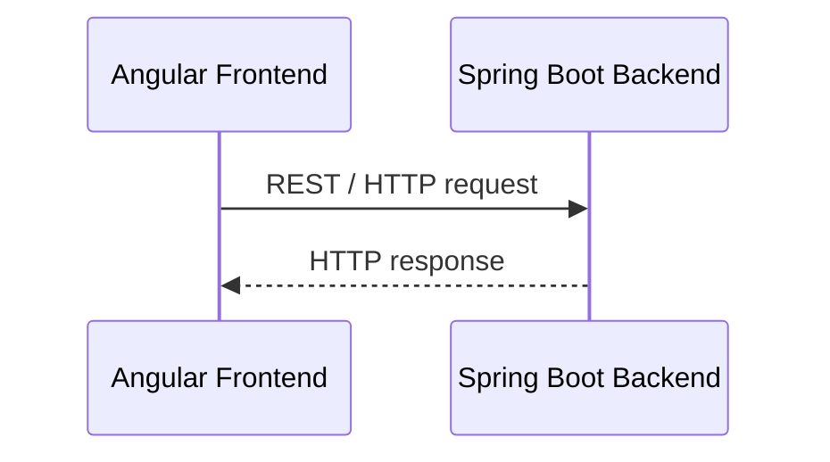

# API Conventions

## Status

**Confirmed:** The Angular frontend and Spring Boot backend communicate through REST/HTTP.

No concrete endpoint contract is documented here yet.

## Confirmed boundary

The diagram confirms only the communication style. It does not define URLs, methods, payloads, status codes, or authentication.

## To be defined

| Concern | Status |
| --- | --- |
| Base path and API versioning | TBD |
| Resource naming | TBD |
| Request and response media types | TBD |
| Field naming and date/time formats | TBD |
| Pagination, filtering, and sorting | TBD |
| Validation contract | TBD |
| Authentication transport | TBD |
| Authorization behavior | TBD |
| Idempotency | TBD |
| Correlation or request identifiers | TBD |
| Deprecation and compatibility policy | TBD |
| API specification format | TBD |

## Documentation rule

When an API contract is approved or verified:

- Document behavior from the authoritative implementation or specification.
- Include request/response examples only when they are real and maintained.
- Link domain terms to [`../domain/`](../domain/user.md).
- Document failure behavior in [error handling](error-handling.md).
- Never invent an endpoint to complete a documentation page.

