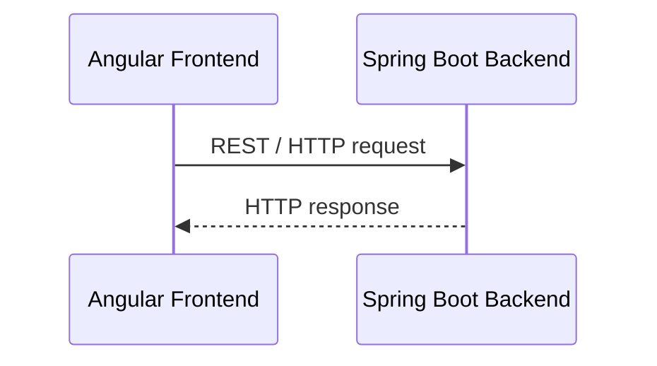

# API Conventions

## Status

**Confirmed:** The Angular frontend and Spring Boot backend communicate through REST/HTTP.

The current implementation uses `/api` as its API base path. No version segment is configured. Only the health endpoint documented below is currently implemented and verified from source.

## Confirmed boundary



During local development, Angular proxies `/api` requests to `http://localhost:8081`. Both frontend environment files currently use `/api`; production infrastructure must route that path to the backend or explicitly change the production API URL.

## Verified current endpoint

### `GET /api/health`

- Purpose: report that the backend process is responding
- Authentication: public
- Success status: `200 OK`
- Response media type: JSON through the current Spring Web MVC configuration

```json
{
  "status": "UP",
  "service": "tutor-backend",
  "timestamp": "<ISO-8601 instant>"
}
```

| Field | Current type and behavior |
| --- | --- |
| `status` | String; currently returns `UP` |
| `service` | String; currently returns `tutor-backend` |
| `timestamp` | String representation of the backend `java.time.Instant` generated for the response |

This endpoint confirms process responsiveness only. It does not currently verify database health or the health of another dependency.

## Current security and CORS baseline

- The backend security configuration is stateless and permits all `OPTIONS` requests.
- `GET /api/health` is public; the security configuration marks every other request as requiring authentication.
- The frontend auth interceptor adds `Authorization: Bearer <token>` when an access token exists in client storage.
- No backend token-validation mechanism or completed sign-in flow is implemented, so Bearer authentication is currently a client-side scaffold rather than a verified end-to-end contract.
- CORS applies to `/api/**`, allows one configured frontend origin, allows credentials, and currently permits `GET`, `POST`, `PUT`, `PATCH`, `DELETE`, and `OPTIONS` with `Authorization`, `Content-Type`, and `Accept` request headers.
- The configured CORS origin defaults to `http://localhost:4200` and can be overridden with `FRONTEND_URL`.

## To be defined

| Concern | Status |
| --- | --- |
| Base path | Current implementation uses `/api` |
| API versioning | TBD; no version segment is configured |
| Resource naming | TBD |
| Request and response media types | JSON is verified for the health endpoint; general policy TBD |
| Field naming and date/time formats | Health response uses lower camel-case fields and an `Instant`; general policy TBD |
| Pagination, filtering, and sorting | TBD |
| Validation contract | TBD |
| Authentication transport | Frontend Bearer-token scaffold exists; backend validation contract TBD |
| Authorization behavior | Health is public and other routes are marked authenticated; role and failure behavior TBD |
| Idempotency | TBD |
| Correlation or request identifiers | TBD |
| Deprecation and compatibility policy | TBD |
| API specification format | TBD; no OpenAPI specification is present |

## Documentation rule

When an API contract is approved or verified:

- Document behavior from the authoritative implementation or specification.
- Include request/response examples only when they are real and maintained.
- Link domain terms to [`../domain/`](../domain/user.md).
- Document failure behavior in [error handling](error-handling.md).
- Never invent an endpoint to complete a documentation page.

