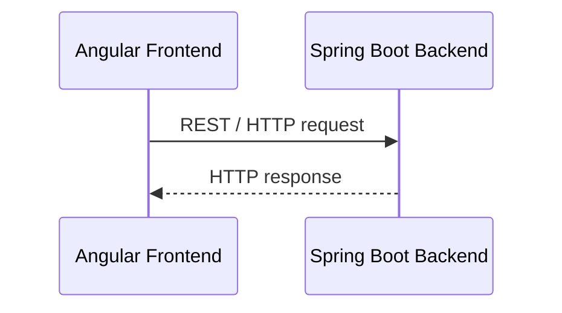

# API Conventions

## Status

**Confirmed:** The Angular frontend and Spring Boot backend communicate through REST/HTTP.

The implementation uses `/api` with no version segment. The health endpoint below and [TUTOR-5 authentication operations](authentication.md) are implemented in local source. Live deployment and browser acceptance checks remain pending.

## Confirmed boundary



During local development, Angular proxies `/api` requests to `http://localhost:8081`. Both frontend environment files currently use `/api`; production infrastructure must route that path to the backend or explicitly change the production API URL.

## Verified current endpoint

### `GET /api/health`

- Purpose: report that the backend process is responding
- Authentication: public
- Success status: `200 OK`
- Response media type: JSON through the current Spring Web MVC configuration

```json
{
  "status": "UP",
  "service": "tutor-backend",
  "timestamp": "<ISO-8601 instant>"
}
```

| Field | Current type and behavior |
| --- | --- |
| `status` | String; currently returns `UP` |
| `service` | String; currently returns `tutor-backend` |
| `timestamp` | String representation of the backend `java.time.Instant` generated for the response |

This endpoint confirms process responsiveness only. It does not currently verify database health or the health of another dependency.

## Current security and CORS baseline

- Security is stateless. Health, CSRF bootstrap and registration/login/refresh are explicitly public; other requests require a validated JWT and active database session.
- Unsafe operations require CSRF protection. A JavaScript-readable `XSRF-TOKEN` cookie pairs with `X-XSRF-TOKEN`.
- The frontend attaches its memory-only access JWT only to relative `/api/` requests requiring it. Refresh credentials use an HttpOnly cookie scoped to `/api/auth`.
- Credentialed CORS applies to `/api/**`, accepts explicit comma-separated `FRONTEND_URL` origins (default `http://localhost:4200`) and rejects wildcard origins. Allowed headers include `Authorization`, `Content-Type`, `Accept`, `X-XSRF-TOKEN` and `admin-register-key`.
- See [authentication](authentication.md) for endpoint transport, cookie policy, expiry/rotation and browser restoration.

## To be defined

| Concern | Status |
| --- | --- |
| Base path | Current implementation uses `/api` |
| API versioning | TBD; no version segment is configured |
| Resource naming | TBD |
| Request and response media types | JSON is verified for the health endpoint; general policy TBD |
| Field naming and date/time formats | Health response uses lower camel-case fields and an `Instant`; general policy TBD |
| Pagination, filtering, and sorting | TBD |
| Validation contract | Authentication uses stable errors with inline `fieldErrors`; unknown properties/multiple roles fail |
| Authentication transport | Memory Bearer JWT plus HttpOnly rotating refresh cookie; see authentication contract |
| Authorization behavior | Database session and server-confirmed roles; feature-specific permissions remain TBD |
| Idempotency | TBD |
| Correlation or request identifiers | Error responses contain server-generated `requestId`, also returned as `X-Request-ID` |
| Deprecation and compatibility policy | TBD |
| API specification format | TBD; no OpenAPI specification is present |

## Documentation rule

When an API contract is approved or verified:

- Document behavior from the authoritative implementation or specification.
- Include request/response examples only when they are real and maintained.
- Link domain terms to [`../domain/`](../domain/user.md).
- Document failure behavior in [error handling](error-handling.md).
- Never invent an endpoint to complete a documentation page.

