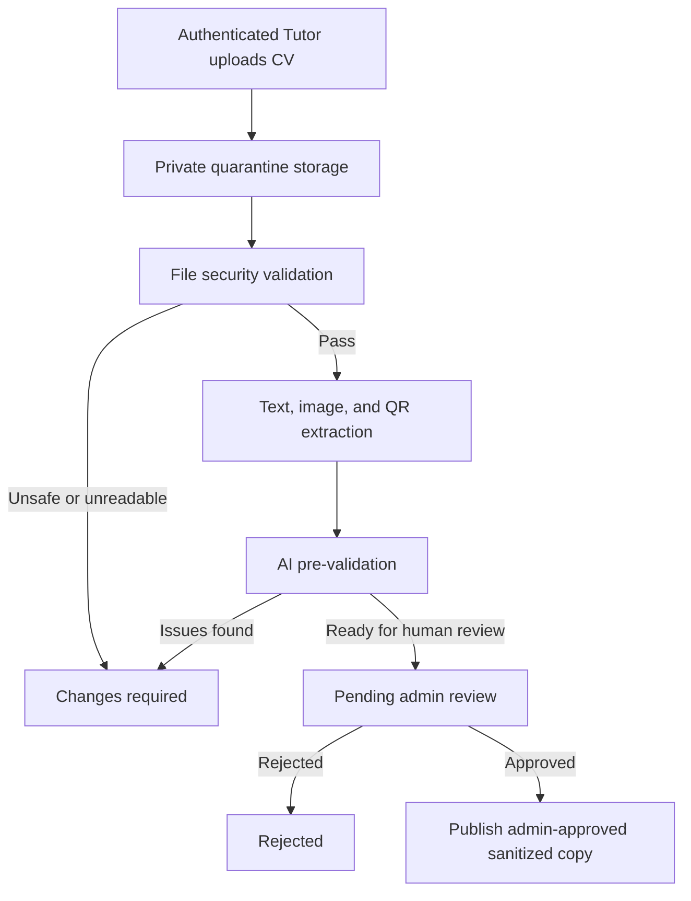

# AI-Assisted CV Review

## Status

**Confirmed:** AI performs automated pre-validation of Tutor CVs. An administrator remains responsible for final approval before a CV or Tutor profile becomes public.

The AI provider, model, prompts, confidence thresholds, file-processing libraries, and storage provider are **TBD**.

## Review pipeline

## File security validation

Security controls run before AI processing and must include:

- Allowlisted file formats
- File extension, MIME type, and file-signature validation
- File-size and processing-resource limits
- Malware scanning
- Safe application-generated storage names
- Storage outside the public web root or equivalent private object storage
- Authorization checks for every original-file access

Exact allowed formats and size limits remain **TBD**.

## AI pre-validation scope

The review examines extracted text, images, watermarks, and QR codes. It must flag:

- Phone numbers
- Email addresses
- Zalo identifiers
- Social-media handles or links
- Personal websites
- QR codes or images containing contact channels
- Obfuscated contact information
- Files that do not appear to be CVs
- Missing expected CV content
- Material inconsistencies between the CV and structured Tutor-profile fields

AI findings must include a category, confidence, and page or location when available so an administrator can review them efficiently.

## Human-review boundary

AI must not:

- Give final profile approval
- Assert that qualifications, certificates, or experience are authentic
- Rank Tutor quality based on age, gender, appearance, or other irrelevant personal characteristics
- Silently alter the original CV

The original CV remains private. The system creates a sanitized public copy, and an administrator compares the source, AI findings, and sanitized copy before approval. Only the administrator-approved sanitized copy may appear on the Tutor detail page.

## Privacy and data handling

- The upload flow must explain that the CV is processed using AI and may be published after sanitization and administrator approval.
- Processing must be limited to CV validation, profile review, and creation of the public sanitized copy.
- Extracted CV content and detected personal data must not be written to ordinary application logs.
- The AI service must not use CV content to train shared models unless a separately approved policy and valid consent permit it.
- Retention, deletion, third-party processing, and cross-border data-transfer rules remain **TBD** and require legal review for the Vietnamese market.

## Quality and audit requirements

- Store review status, timestamps, rules/model version, findings, administrator decision, and decision reason.
- Maintain test cases for normal CVs, contact information, obfuscated contact information, QR codes, image-only CVs, malformed files, and false positives.
- Measure missed contact information and incorrect flags before allowing the system to publish sanitized copies.
- AI or extraction failure must fail safely into manual review; it must never publish the CV automatically.

## References

- [OWASP File Upload Cheat Sheet](https://cheatsheetseries.owasp.org/cheatsheets/File_Upload_Cheat_Sheet.html)
- [NIST AI Risk Management Framework](https://www.nist.gov/itl/ai-risk-management-framework)
- [Vietnam Personal Data Protection Law 91/2025/QH15](https://vanban.chinhphu.vn/?docid=214590&pageid=27160)

