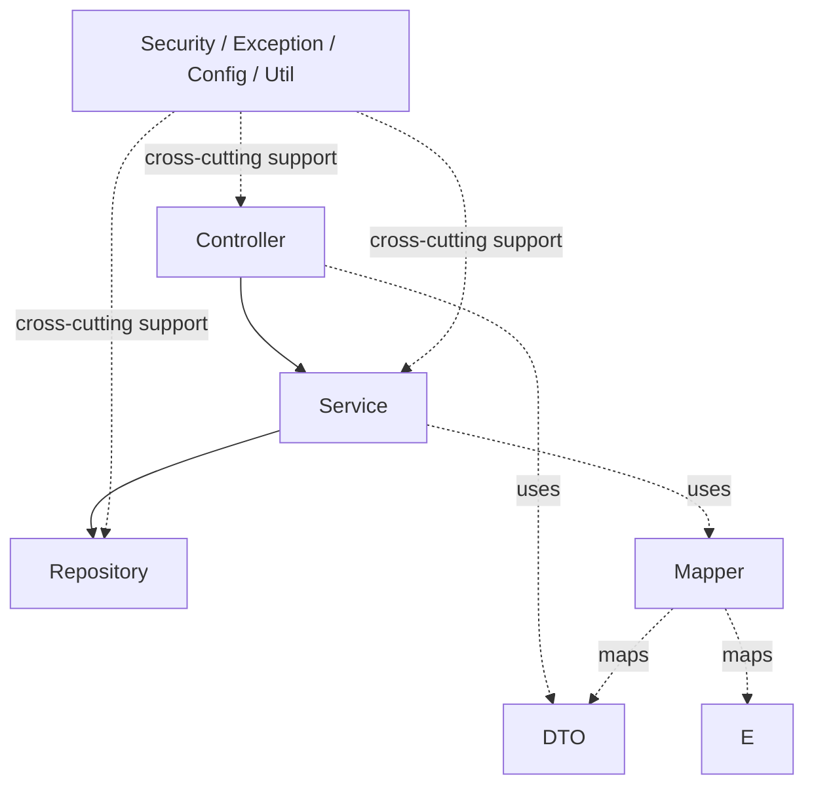

# Backend Architecture

## Status

**Confirmed:** The `tutor-backend` repository uses Spring Boot 4.1.1, Java 21, and Maven. Its base Java package is `com.tutormarketplace`. The repository can communicate locally with the frontend and contains the scaffolded layer areas listed below.

The Maven Wrapper is configured to use Maven 3.10.0. Versions recorded here describe the current source baseline; the version-upgrade policy remains **TBD**.

**Database status:** **Connected; official schema pending.** The backend is configured to connect to Supabase PostgreSQL and uses Spring Data JPA, the PostgreSQL driver, and Flyway. The official application schema and MVP persistence model have not yet been defined or implemented.

## Repository

**TUTOR-4 update:** Four local Flyway migrations, backend enum definitions and real PostgreSQL verification tests now implement the persistence foundation. Live Supabase deployment and feature services remain pending. This update supersedes the older schema-pending baseline descriptions on this page; see [Database schema](../database/schema.md) for the migration chain, permissions and remaining responsibilities.

`tutor-backend`

## Current implementation baseline

The current implemented backend code is limited to:

- The Spring Boot application entry point
- `GET /api/health` and its response DTO
- Stateless Spring Security and CORS configuration
- Supabase PostgreSQL datasource configuration
- Spring Data JPA and Flyway configuration

Service, Repository, Entity, Mapper, Exception, Security, and Util package areas are currently scaffolding or placeholders unless source code added by a later ticket proves otherwise.

## Scaffolded logical structure

The diagram expresses the intended layered organization represented by the scaffolded packages. It is not a claim that every layer already contains implemented classes or that the displayed class-level dependency flow currently exists.

| Layer / area | Known purpose |
| --- | --- |
| Controller | HTTP boundary |
| Service | Application/service logic |
| Repository | Repository layer; MVP persistence behavior awaits the official schema ticket |
| Entity | Entity layer; official database mappings have not yet been defined |
| DTO | Boundary data-transfer objects |
| Mapper | Conversion between representations |
| Security | Security concerns; detailed rules are **TBD** |
| Exception | Exception concerns; response contract is **TBD** |
| Config | Application configuration |
| Util | Shared utilities |

## External connections

- Accepts REST/HTTP communication from the Angular frontend.
- Connects to Supabase PostgreSQL through configurable datasource credentials.
- Uses Flyway as the configured database-migration mechanism.
- The official MVP schema, application entities, repositories, relationships, constraints, and migrations will be defined and created through the next planned development ticket after the current KB grooming is complete.
- After that ticket is completed and verified, update the database and backend documentation with the implemented state.

## To be defined

- Subpackage rules and allowed dependency directions below `com.tutormarketplace`
- Version-upgrade and dependency-management policy
- Authentication and authorization design
- Transaction boundaries
- Validation approach
- Logging and observability
- API versioning and serialization conventions
- MVP persistence model and migration contents
- Background processing and external integrations

See [backend conventions](../standards/backend-conventions.md) before adding standards.

