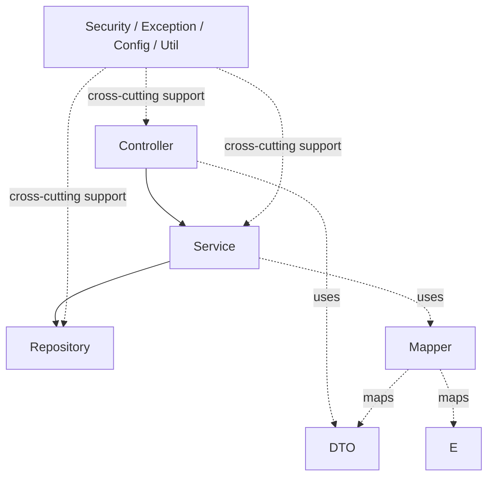

# Backend Architecture

## Status

**Confirmed:** The `tutor-backend` repository uses Spring Boot 4.1.1, Java 21, and Maven. Its base Java package is `com.tutormarketplace`. The repository can communicate locally with the frontend and contains the scaffolded layer areas listed below.

The Maven Wrapper is configured to use Maven 3.10.0. Versions recorded here describe the current source baseline; the version-upgrade policy remains **TBD**.

**Database status:** The TUTOR-4 foundation is implemented in source and tested on isolated PostgreSQL 17. Live Supabase migration state is not verified. Authentication persistence uses JPA entities, Spring Data JPA repositories and Hibernate, with the PostgreSQL driver and Flyway.

## Repository

**TUTOR-4/TUTOR-5 update:** Four local Flyway migrations and backend enums establish persistence. Authentication services now reuse that foundation; other feature services and live deployment remain pending. See [Database schema](../database/schema.md) and [authentication](../api/authentication.md).

`tutor-backend`

## Current implementation baseline

The backend now implements:

- The Spring Boot application entry point
- `GET /api/health` and its response DTO
- Stateless Spring Security and CORS configuration
- Supabase PostgreSQL datasource configuration
- Spring Data JPA and Flyway configuration
- TUTOR-4 persistence foundation and TUTOR-5 transactional authentication using JPA entities and Spring Data JPA repositories
- RSA JWT validation, rotating hashed refresh credentials, session revocation, CSRF and shared security/application errors

Authentication occupies Controller, Service, Repository, Entity, DTO, Exception, Security and Config. Service transactions use JPA. Spring Data queries and explicit refreshes acquire pessimistic user locks before session locks and reload managed state after lock acquisition. Aggregate creation uses `EntityManager.persist`; session rotation uses dirty checking and revocation uses JPQL. Other feature areas remain scaffolding. See [authentication](../api/authentication.md) for the local contract and pending deployment/browser checks.

## Scaffolded logical structure

The diagram expresses the intended layered organization represented by the scaffolded packages. It is not a claim that every layer already contains implemented classes or that the displayed class-level dependency flow currently exists.

| Layer / area | Known purpose |
| --- | --- |
| Controller | HTTP boundary |
| Service | Application/service logic |
| Repository | Spring Data JPA queries/locks, JPQL revocation and aggregate persistence coordination |
| Entity | Private-schema JPA mappings with shared profile/credential keys and string-valued enums |
| DTO | Boundary data-transfer objects |
| Mapper | Conversion between representations |
| Security | JWT/session checks, cookie/CSRF policy and server-confirmed roles; feature permissions remain TBD |
| Exception | Shared API/security errors and controlled identity conflicts |
| Config | Application configuration |
| Util | Shared utilities |

## External connections

- Accepts REST/HTTP communication from the Angular frontend.
- Connects to Supabase PostgreSQL through configurable datasource credentials.
- Uses Flyway as the configured database-migration mechanism.
- Source-controlled migrations define the persistence foundation. Later feature work extends it through new migrations when needed.

## To be defined

- Subpackage rules and allowed dependency directions below `com.tutormarketplace`
- Version-upgrade and dependency-management policy
- Authentication and authorization design
- Transaction boundaries
- Validation approach
- Logging and observability
- API versioning and serialization conventions
- MVP persistence model and migration contents
- Background processing and external integrations

See [backend conventions](../standards/backend-conventions.md) before adding standards.

