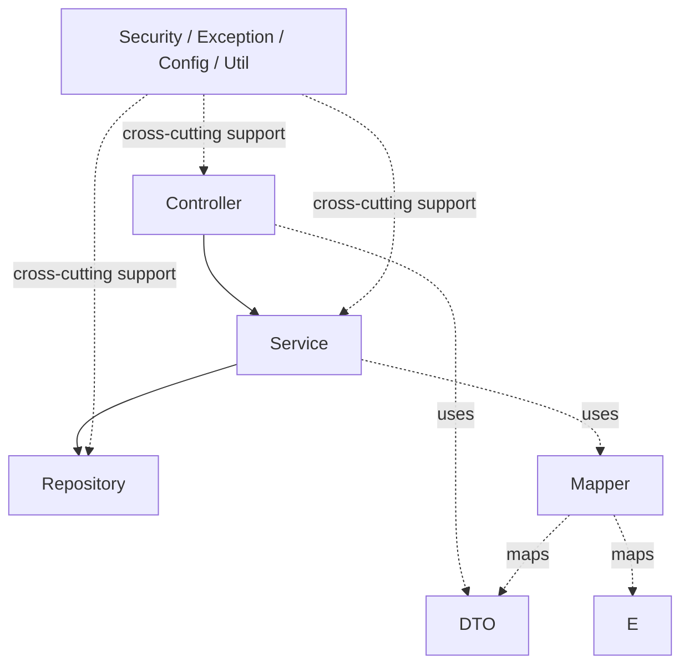

# Backend Architecture

## Status

**Confirmed:** The `tutor-backend` Spring Boot repository is initialized, can communicate locally with the frontend, and follows the layers listed below.

Backend framework version, Java version, build tool, package names, and dependency versions are **TBD** in this KB and must be verified in `tutor-backend`.

**Database status:** **TBD / Not implemented.** No database connection, schema, or persistence implementation is confirmed.

## Repository

`tutor-backend`

## Current logical structure

The diagram expresses the known layered organization, not a verified class-level dependency graph or implemented persistence flow.

| Layer / area | Known purpose |
| --- | --- |
| Controller | HTTP boundary |
| Service | Application/service logic |
| Repository | Repository layer; persistence behavior is **TBD** |
| Entity | Entity layer; database mapping is **TBD** |
| DTO | Boundary data-transfer objects |
| Mapper | Conversion between representations |
| Security | Security concerns; detailed rules are **TBD** |
| Exception | Exception concerns; response contract is **TBD** |
| Config | Application configuration |
| Util | Shared utilities |

## External connections

- Accepts REST/HTTP communication from the Angular frontend.
- Does not have a confirmed database connection.
- Database technology, design, initialization, and integration are **TBD** and will be handled through a future Jira ticket.

## To be defined

- Exact package layout and allowed dependency directions
- Authentication and authorization design
- Transaction boundaries
- Validation approach
- Logging and observability
- API versioning and serialization conventions
- Database integration approach
- Background processing and external integrations

See [backend conventions](../standards/backend-conventions.md) before adding standards.

