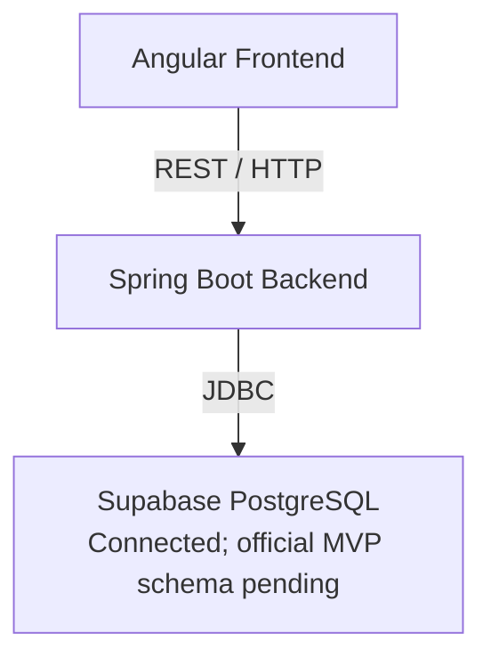
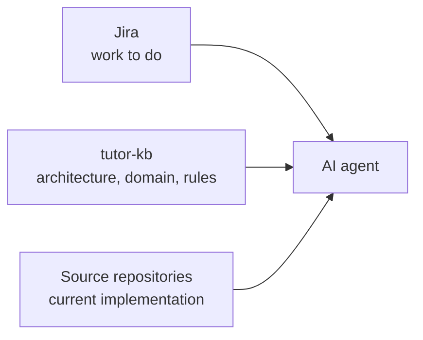

# System Overview

## Status

This document separates the current confirmed system from future or TBD work.

## Current architecture



```text
Database connection: Supabase PostgreSQL / Connected
Official MVP schema: Not yet defined
```

| Component | Repository | Current status |
| --- | --- | --- |
| Angular frontend | `tutor-frontend` | Repository initialized |
| Spring Boot backend | `tutor-backend` | Repository initialized |
| Knowledge base | `tutor-kb` | Active; this repository |
| Database | Supabase PostgreSQL | Backend connection configured; official MVP schema not yet defined |

The frontend and backend can communicate successfully in the local development environment.

## Confirmed customer account types

- Tutor
- Tutor Seeker

These are separate, mutually exclusive customer account types. There is no separate Parent role. A student may register directly as a Tutor Seeker without being attached to a parent account.

The product serves these customers in Vietnam and supports online and in-person tutoring.

## Supporting actor

- Administrators

The administrator identity model, detailed permissions, account-type transitions, and authorization rules are **TBD**.

## Planned product domains

- Users
- Tutor profiles
- Job postings
- Tutor discovery
- Applications
- Sessions
- Payments
- Reviews
- AI-assisted tutor matching

These names describe planned product scope, not confirmed feature implementation. Domain workflows and cross-domain ownership are **TBD** unless documented in [`../domain/`](../domain/user.md).

Authentication, approved Tutor profiles, tutor search/list/details, AI-assisted recommendations, free connection requests, contact unlock after acceptance, connection history, and reviews from connected Tutor Seekers are confirmed MVP requirements. Job postings, formal lesson/session management, tutoring-fee payments, and connection credits are post-MVP. See [Product Scope](../product/scope.md).

AI tutor recommendations use a conversational experience. The AI may ask follow-up questions and can recommend only administrator-approved Tutor profiles. See [AI Tutor Matching](../domain/ai-matching.md).

Tutor CV review uses AI for automated pre-validation and requires final administrator approval before publication. See [AI-Assisted CV Review](ai-cv-review.md).

## Current component boundaries

- The frontend communicates with the backend through REST/HTTP.
- The backend is connected to Supabase PostgreSQL through JDBC configuration.
- No official application schema or approved MVP migrations are defined yet.
- Deployment topology, environments, infrastructure, and observability are **TBD**.

## Planned architecture

The following items are planned or TBD, not current runtime components:

- Jira configuration
- MVP database schema design and creation
- `tutor-agent` configuration
- Planner Agent
- Developer Agent
- Reviewer Agent
- MCP integrations and MCP-based consumption of this knowledge base

Supabase PostgreSQL is the confirmed database technology and the backend connection is configured. Application entities, relationships, constraints, indexes, seed/reference data, and the official Flyway migrations required for the MVP remain to be defined by the planned schema ticket.

### Next planned development ticket

After the current KB grooming is completed, **MVP Database Schema Design & Creation** is the next planned development ticket. It will define and create the official schema required to build the MVP. This document does not pre-empt that design. After the ticket is completed and verified, the implemented schema must be documented in this KB.

Expected future agent context model, after Jira and MCP integrations are configured:



Agent implementation, permissions, workflows, and MCP configuration are **TBD**. Jira and MCP integrations are not configured yet.

## Related documents

- [Backend architecture](backend.md)
- [Frontend architecture](frontend.md)
- [AI-assisted CV review](ai-cv-review.md)
- [API conventions](../api/conventions.md)
- [Database schema](../database/schema.md)

