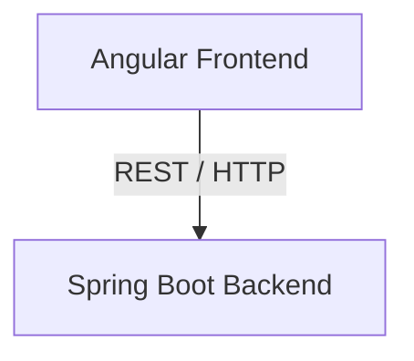
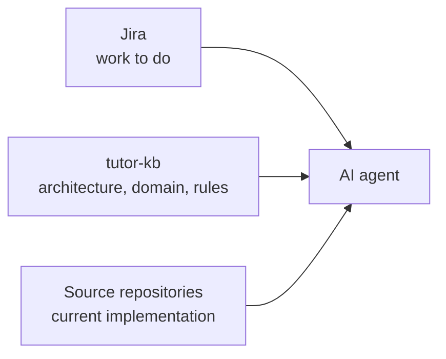

# System Overview

## Status

This document separates the current confirmed system from future or TBD work.

## Current architecture



```text
Database: TBD / Not implemented
```

| Component | Repository | Current status |
| --- | --- | --- |
| Angular frontend | `tutor-frontend` | Repository initialized |
| Spring Boot backend | `tutor-backend` | Repository initialized |
| Knowledge base | `tutor-kb` | Active; this repository |
| Database | None | Not designed, created, or initialized |

The frontend and backend can communicate successfully in the local development environment.

## Planned product actors

- Students / Parents
- Tutors
- Administrators

Actor permissions, identity relationships, and authorization rules are **TBD**.

## Planned product domains

- Users
- Tutor profiles
- Job postings
- Tutor discovery
- Applications
- Sessions
- Payments
- Reviews
- AI-assisted tutor matching

These names describe planned product scope, not confirmed feature implementation. Domain workflows and cross-domain ownership are **TBD** unless documented in [`../domain/`](../domain/user.md).

## Current component boundaries

- The frontend communicates with the backend through REST/HTTP.
- No database exists or is connected.
- Deployment topology, environments, infrastructure, and observability are **TBD**.

## Planned architecture

The following items are planned or TBD, not current runtime components:

- Jira configuration
- Database design and initialization
- `tutor-agent` configuration
- Planner Agent
- Developer Agent
- Reviewer Agent
- MCP integrations and MCP-based consumption of this knowledge base

PostgreSQL and Supabase have been discussed as possible future technology, but their selection and configuration are **Planned / TBD**, not implemented.

### First planned development ticket

**Database Design & Initial Setup** is the first planned development ticket. This is roadmap information only; the ticket will later define requirements and acceptance criteria. This document does not design the database.

Expected future agent context model, after Jira and MCP integrations are configured:



Agent implementation, permissions, workflows, and MCP configuration are **TBD**. Jira and MCP integrations are not configured yet.

## Related documents

- [Backend architecture](backend.md)
- [Frontend architecture](frontend.md)
- [API conventions](../api/conventions.md)
- [Database schema](../database/schema.md)

