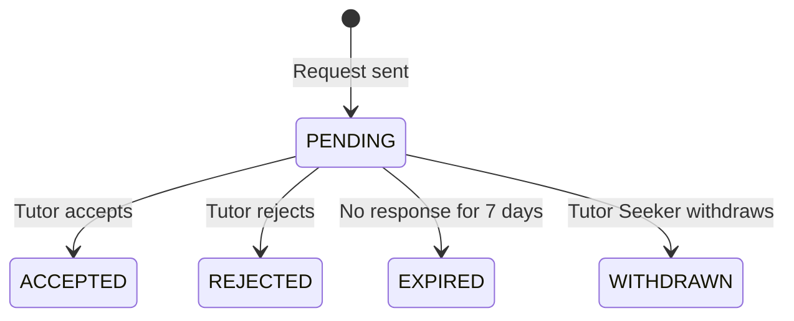

# Connection Request / Application Domain

## Status

**Confirmed product concept:** A Tutor Seeker sends a connection request to a Tutor. The Tutor accepts or rejects it.

No application feature implementation is confirmed by this page.

## Scope

A Tutor Seeker initiates a connection request after reviewing a Tutor profile. The Tutor is the request recipient. The two accounts become connected when the Tutor accepts the request. Sending and accepting requests are free in the MVP.

## Confirmed minimum lifecycle

Only `ACCEPTED` creates a connection between the Tutor and Tutor Seeker. It unlocks contact information for both parties and creates the Tutor Seeker's connection-history entry at no charge in the MVP.

Pending and rejected requests do not expose contact information. No credit or payment is required to accept in the MVP.

A request remaining in `PENDING` for 7 days without a Tutor response automatically becomes `EXPIRED`. An expired request cannot be accepted or rejected and does not create a connection.

A Tutor Seeker may withdraw a request while it is `PENDING`. The request becomes `WITHDRAWN`; the Tutor can no longer accept or reject it, and no connection is created.

Each Tutor Seeker–Tutor pair may have at most one `PENDING` connection request at a time. The system must reject an attempt to create another request for the same pair while one remains pending.

After an `EXPIRED` or `WITHDRAWN` request, the Tutor Seeker may send a new request to the same Tutor immediately. After a `REJECTED` request, the Tutor Seeker must wait 30 days before sending another request to the same Tutor.

## Confirmed email notifications

The MVP uses email notifications only. It does not include a web notification center, mobile push notifications, or SMS notifications.

| Event | Email recipient |
| --- | --- |
| New connection request | Tutor |
| Request accepted | Tutor Seeker and Tutor |
| Request rejected | Tutor Seeker |
| Request expired | Tutor Seeker |
| Request withdrawn | Tutor |

## Confirmed request content

| Information | Requirement |
| --- | --- |
| Subject | Required |
| Grade level or current proficiency | Required |
| Learning goal | Required |
| Online or in-person teaching mode | Required |
| Location or teaching area | Required for in-person requests |
| Desired availability or schedule | Required |
| Tutoring-rate budget range | Required |
| Additional message | Optional |

Before acceptance, request content must not expose phone numbers, email addresses, Zalo identifiers, social-media handles, personal websites, or other contact channels. This restriction applies to every structured field and the optional message.

## To be defined

- Relationship to jobs, tutors, and users
- Visibility and authorization rules
- Audit history
- Relationship to sessions and payments

## Related domains

- [User](user.md)
- [Tutor](tutor.md)
- [Job](job.md)
- [Payment](payment.md)
- [Tutor connection and learning history](session.md)
- [Monetization](../product/monetization.md)

