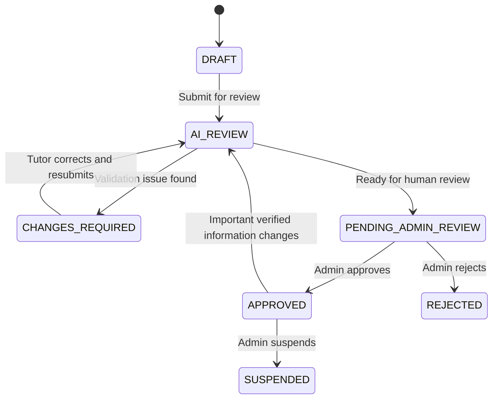

# Tutor Domain

## Status

**Confirmed product scope:** Tutor is a customer account type. Tutor search, tutor list/search-results, tutor details, and AI-assisted tutor recommendations are required MVP capabilities for the Vietnamese market.

No tutor profile or discovery feature implementation is confirmed by this page.

**TUTOR-4 foundation:** Local migrations now represent profile data, VND-per-hour rate ranges, recurring weekly availability, CV versions and manual administrator approval. AI review persistence is deferred. The foundation uses `DRAFT`, `PENDING_ADMIN_REVIEW`, `APPROVED`, `REJECTED`, `SUSPENDED`, with submission/re-review moving directly to administrator review. The eventual AI lifecycle below remains future integration work. See [Database schema](../database/schema.md) for the implemented persistence boundary; live deployment and feature services are pending.

## Scope

This page is the future source of truth for tutor-specific concepts. It does not yet define a profile schema or discovery behavior.

## Confirmed profile information

A tutor profile contains the following information:

| Information | Requirement | Visibility |
| --- | --- | --- |
| Full name | Required | Public tutor profile |
| Profile photo | Required | Public tutor profile |
| Personal introduction | Required | Public tutor profile |
| Province/city and teaching areas | Required | Public tutor profile |
| Online and/or in-person teaching mode | Required | Public tutor profile |
| Subjects and grade levels | Required | Public tutor profile |
| Education and major | Required | Public tutor profile |
| Teaching experience | Required | Public tutor profile |
| Certificates and achievements | Optional | Public tutor profile when provided |
| Tutoring rate | Required | Public tutor profile |
| Teaching availability | Required | Public tutor profile |
| Email address | Required | Private before connection; available to the connected Tutor Seeker after acceptance |
| Phone number | Required; not SMS-verified in the MVP | Private before connection; available to the connected Tutor Seeker after acceptance |
| Curriculum vitae (CV) | Required | Public on an approved tutor detail profile after administrator review |

Before approval, AI performs automated pre-validation and an administrator verifies that the public CV contains no phone number, email address, Zalo identifier, social-media handle, personal website, or other contact channel. A CV containing contact information must not be published. The original remains private; only an administrator-approved sanitized copy is public. See [AI-Assisted CV Review](../architecture/ai-cv-review.md).

Exact file formats, file-size limits, replacement, retention, and third-party AI-processing rules remain **TBD**.

## Confirmed tutor discovery

Tutor search supports filtering by:

- Subject
- Grade level
- Province/city and teaching area
- Online or in-person teaching mode
- Tutoring-rate range
- Teaching availability
- Teaching experience
- Rating

The tutor list/search-results view displays:

- Profile photo
- Full name
- Subjects and grade levels
- Province/city or teaching area
- Online and/or in-person teaching mode
- Teaching experience
- Tutoring rate
- Rating
- Verification badge

The tutor detail view displays all confirmed public tutor-profile information, including the administrator-reviewed CV. Private contact information must not be exposed on either the list or detail view.

Filter operators, sorting, pagination, default ranking, empty-state behavior, and the exact list-card layout remain **TBD**.

Only administrator-approved tutor profiles appear publicly or in tutor discovery. Approved profiles display a verification badge. Verification status is therefore not exposed as a search filter.

## Confirmed approval lifecycle

| Status | Public visibility |
| --- | --- |
| `DRAFT` | Hidden |
| `AI_REVIEW` | Hidden |
| `CHANGES_REQUIRED` | Hidden |
| `PENDING_ADMIN_REVIEW` | Hidden |
| `APPROVED` | Visible with a verification badge |
| `REJECTED` | Hidden |
| `SUSPENDED` | Hidden |

Changing a CV, qualification, certificate, achievement, teaching experience, or other important professional information on an approved profile returns it to `AI_REVIEW`. Because only `APPROVED` profiles are public, the profile is hidden throughout automated and administrator re-review.

Rejection reasons, resubmission rules, suspension reasons, appeal behavior, review time targets, and which additional field changes trigger re-review remain **TBD**.

## To be defined

- Relationship between a user and a tutor profile
- CV upload format, retention period, and approved AI provider
- Subjects, skills, qualifications, and verification
- Availability and location representation
- Pricing or rate representation
- Profile visibility and lifecycle
- Discovery sorting and ranking
- Tutor eligibility rules
- AI-assisted matching inputs and outputs
- Online versus in-person tutoring representation
- In-person location and travel-distance rules
- Administrator approval workflow and verification evidence

No matching or ranking algorithm has been approved or documented.

## Related domains

- [User](user.md)
- [Application](application.md)
- [Payment](payment.md)
- [Review](review.md)
- [AI tutor matching](ai-matching.md)
- [Product scope](../product/scope.md)

