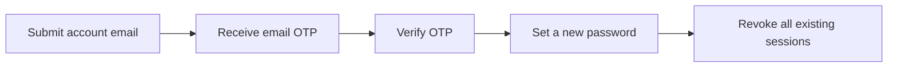

# User Domain

## Status

**Confirmed product model:** Customers use one of two separate account types: Tutor or Tutor Seeker.

TUTOR-5 now implements local registration and authentication. See the [authentication contract](../api/authentication.md); live deployment and browser verification remain pending.

**TUTOR-4 identity decision:** Application-managed authentication uses one shared `app_user` identity with one Java-defined role: `TUTOR`, `TUTOR_SEEKER`, or `ADMIN`. Customer profiles are separate and mutually exclusive; administrators use the shared identity without a customer profile. Normalized username and email are unique. TUTOR-5 consumes these structures without schema changes. See [Database schema](../database/schema.md), which supersedes the identity-model TBDs below.

## Known vocabulary

| Term | Confirmed meaning |
| --- | --- |
| Tutor Seeker | A customer account used by anyone who has a need to find a tutor |
| Tutor | A customer account used by a tutor; tutor-specific data is covered in [Tutor](tutor.md) |
| Student | A person who may register directly as a Tutor Seeker |
| Parent | Not a distinct role or account type; a parent may use a Tutor Seeker account |
| Administrator | Shared identity with ADMIN role; API registration requires an externally configured provisioning key |

Tutor and Tutor Seeker are separate, mutually exclusive account types. A customer account cannot hold both types. A student does not need to be attached to a parent account to register.

## Confirmed tutor-seeking model

A Tutor Seeker may search for a tutor whenever they have a tutoring need. The system does not need to determine whether the search is for the account holder, a child, or another person.

The MVP does not require separate learner profiles, parent-student relationships, or identification of the intended learner. Search and recommendation criteria describe the tutoring need rather than a modeled relationship to a learner.

## Confirmed Tutor Seeker information

| Information | Requirement | Visibility |
| --- | --- | --- |
| Username | Required | Private account identifier |
| Verified email address | Required | Private before connection; available to a connected Tutor after acceptance |
| Full name | Required | Account information; available to a connected Tutor after acceptance |
| Phone number | Required | Private before connection; available to a connected Tutor after acceptance |
| Profile photo | Optional | Visible to a connected Tutor after acceptance |

Date of birth, gender, a separate learner profile, and the identity of the person receiving tutoring are not required in the MVP.

## Phone verification

Phone numbers are required contact information but are self-declared and are not verified by SMS OTP in the MVP. This rule applies to both Tutor and Tutor Seeker accounts.

## Confirmed authentication boundary

A Tutor Seeker must be authenticated to use tutor discovery, including search, tutor list/search-results, tutor details, and AI-assisted tutor recommendations.

The account retains a history of tutor connections or relationships. A Tutor Seeker sends the request; the Tutor accepts or rejects it. Acceptance and contact-information unlock create the connection and its history entry. Connections are free in the MVP. See [Tutor connection and learning history](session.md).

## Confirmed registration credentials

- Each customer account has a unique username.
- The primary sign-in credentials are username and password.
- Registration requires an email address.
- An email OTP must be verified before the account becomes active.
- TUTOR-5 temporarily permits unverified sign-in only under the exclusive `local` backend profile. Registration leaves verification unset; email/OTP delivery and activation remain deferred. Non-local authentication still requires verification.
- The activation OTP is used only for initial account activation.
- Routine sign-in requires only username and password.
- These credential rules apply to both Tutor and Tutor Seeker accounts.

OTP usage for other sensitive account changes remains **TBD**.

## Confirmed password policy

- Password length must be between 8 and 128 characters.
- A password must contain at least one letter and at least one digit.
- A password must not be identical to the account username or email address.
- The same rules apply during registration and any future password reset or password change.

## Confirmed password recovery

- Password recovery uses the email address registered to the account.
- A valid email OTP is required before a new password can be set.
- The new password must satisfy the confirmed password policy.
- A successful password reset revokes every existing session for the account and requires a new sign-in.

## Confirmed OTP policy

The following rules apply to both account-activation OTPs and password-recovery OTPs:

- An OTP contains 6 numeric digits.
- An OTP expires 5 minutes after issuance.
- A user may make at most 5 incorrect verification attempts for an OTP.
- A new OTP may be requested no sooner than 60 seconds after the previous request.
- Issuing a new OTP immediately invalidates every previously issued OTP for the same purpose and account.
- After 5 incorrect attempts, the OTP is invalidated and the account cannot request another OTP for 15 minutes.

Broader request-rate limits across accounts, email addresses, and network sources remain **TBD**.

## Failed password attempts

The MVP does not define an account-lockout rule based on a fixed number of incorrect password attempts. Infrastructure-level abuse prevention may be introduced as an implementation security control without changing account business status.

## Confirmed tutor approval requirement

Tutors require administrator approval before their profiles can appear publicly or in tutor discovery. An approved public profile displays a verification badge.

The confirmed approval states and transitions are documented in [Tutor](tutor.md#confirmed-approval-lifecycle).

Verification evidence, review criteria, rejection resubmission, suspension reasons, and appeal rules remain **TBD**.

## To be defined

- Email/OTP implementation and account lifecycle beyond the TUTOR-5 registration/login contract
- Detailed permission model
- Whether an account type can ever be changed
- Administrator feature permissions beyond key-protected API provisioning
- Broader OTP rate limits and feature-specific authorization rules
- Privacy, consent, and data-retention requirements

## Related domains

- [Tutor](tutor.md)
- [Job](job.md)
- [Application](application.md)
- [Payment](payment.md)
- [Review](review.md)
- [Tutor connection and learning history](session.md)

