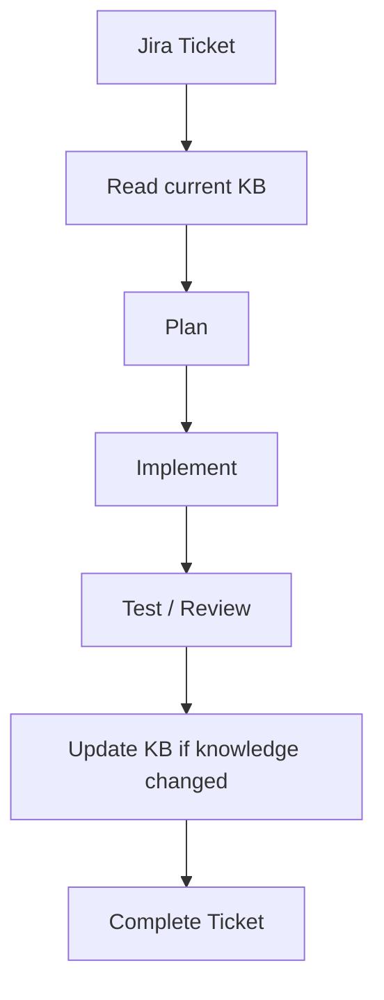

# Git Workflow

## Status

Detailed branching, review, and release conventions are **TBD**.

## Confirmed repository practice

- The Knowledge Base must reflect the actual confirmed state of the project. Planned features, architecture, infrastructure, or business rules must not be documented as implemented.
- Keep the knowledge base documentation-first and Git-friendly.
- Store documentation primarily as Markdown.
- Keep changes focused and reviewable.
- Update documentation when accepted architecture, domain, API, database, or engineering rules change.
- Do not convert assumptions into documented facts.

## Documentation change workflow

When Jira is configured, use this ticket-driven workflow:

When a ticket introduces or changes architecture, domain rules, API contracts, database design, or engineering conventions, update the relevant KB page as part of that ticket and before completing it.

For every documentation change:

1. Identify the verified fact or accepted decision.
2. Update the most specific owning page.
3. Label unresolved information `TBD` or `To be defined`.
4. Add or link an ADR when rationale and trade-offs need a durable record.
5. Check relative links, Markdown rendering, and Mermaid syntax.
6. Review related pages for contradictions.

Jira is planned to be configured next; this workflow is not active yet.

## To be defined

- Branch naming
- Commit message convention
- Pull-request requirements
- Reviewer and approval requirements
- Merge strategy
- Release and tagging process
- CI checks
- Rules shared across the project repositories

